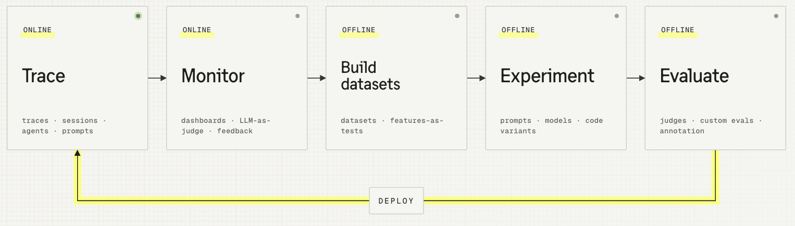
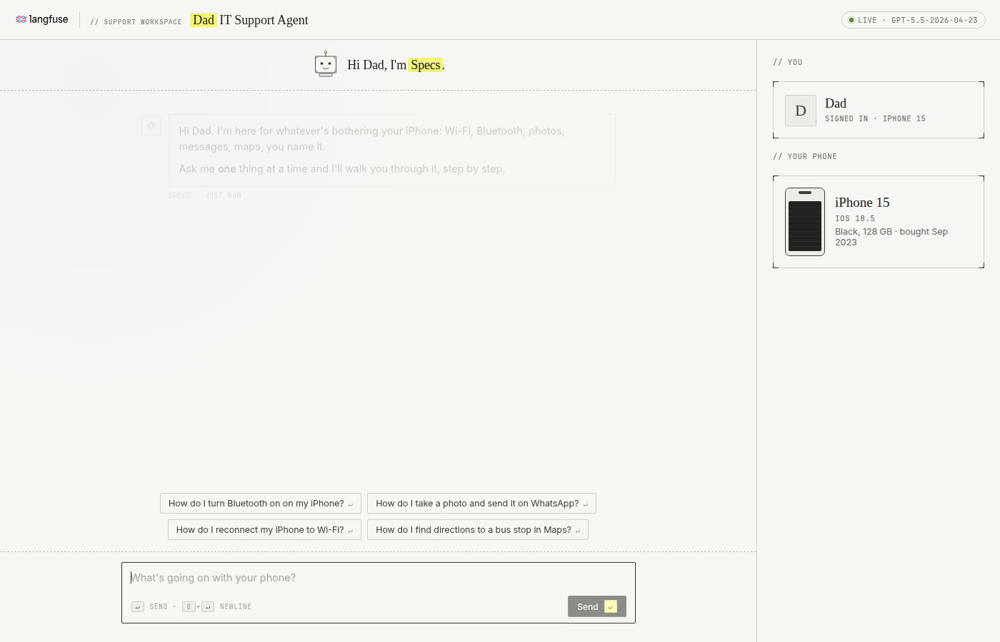

# Langfuse Workshop — the AI engineering loop, in Python

This is a Python port of the [Langfuse workshop](https://github.com/langfuse/langfuse-workshop). It walks the same loop on the same sample product: the **Dad IT Support Agent** (Specs), a small chat where Dad asks for iPhone help. The agent is an OpenAI tool-calling loop with two local tools.

The workshop covers tracing, prompt management, monitoring, datasets, experiments, and evaluation. It is the hands-on version of ideas in the [Langfuse Academy](https://langfuse.com/academy).

The TypeScript repo is the upstream source. This repository lives only in [mohdaliiqbal/langfuse-workshop](https://github.com/mohdaliiqbal/langfuse-workshop). Do not open pull requests against the upstream repo. [SYNC.md](SYNC.md) records the upstream commit this tree was aligned to.

> Use **Langfuse Cloud** so you have the features the lessons describe. Self-hosted instances may be older and will not match the screenshots.
>
> Confirm **AI Features** are on for your organization. If **Halo** is missing, an owner or admin turns them back on under **Organization Settings → General → AI Features**.





## For learners

Start at [docs/learner/00-setup.md](docs/learner/00-setup.md). Each lesson says which checkpoint to load, what to change, and how to check the result in Langfuse.

`main` is the finished reference app. Chapters start from snapshots in `checkpoints/`, applied with:

```bash
uv run python scripts/use_checkpoint.py 02-tracing
```

That command is this repo's equivalent of `git checkout checkpoint/02-tracing` in the TypeScript workshop. `00-setup`, `01-base-app`, and `02-tracing` share the untraced app. `03-prompt-management` is traced and still uses the local prompt. `04-monitoring` onward is the finished app. Put the finished files back with `uv run python scripts/use_checkpoint.py reference`.

## For instructors

Facilitator notes are in [docs/instructor/](docs/instructor/). Preparation notes are in [docs/preparation_and_materials/](docs/preparation_and_materials/).

## Modules

| Step | Lesson | Checkpoint command | What you will learn |
| --- | --- | --- | --- |
| 00 | [Setup](docs/learner/00-setup.md) | `use_checkpoint.py 00-setup` | Keys, install, run the app |
| 01 | [Base app](docs/learner/01-base-app.md) | `use_checkpoint.py 01-base-app` | Tour the running app |
| 02 | [Tracing](docs/learner/02-tracing.md) | `use_checkpoint.py 02-tracing` | Generations, agent root, tool spans |
| 03 | [Prompt management](docs/learner/03-prompt-management.md) | `use_checkpoint.py 03-prompt-management` | Fetch a versioned system prompt |
| 04 | [Monitoring](docs/learner/04-monitoring.md) | `use_checkpoint.py 04-monitoring` | Dashboards, error analysis, signals |
| 05 | [Build eval datasets](docs/learner/05-dataset.md) | `use_checkpoint.py 05-dataset` | Dataset shape and seeding |
| 06 | [Experiments](docs/learner/06-experiments.md) | `use_checkpoint.py 06-experiments` | Run the agent on the dataset and score it |
| 07 | [Evaluation](docs/learner/07-evaluation.md) | `use_checkpoint.py 07-evaluation` | Change the prompt, rerun, compare |
| 08 | [Wrap-up](docs/learner/08-wrap-up.md) | `use_checkpoint.py 08-wrap-up` | Apply the loop to your own app |

## Quick start

```bash
git clone https://github.com/mohdaliiqbal/langfuse-workshop.git
cd langfuse-workshop
./setup.sh
```

`setup.sh` runs `uv sync` and copies `.env.example` to `.env` when `.env` is missing. Then fill in the keys and start the app:

```bash
uv run python -m app.server
```

Open [http://127.0.0.1:3333](http://127.0.0.1:3333). The page and the API are the same process. The TypeScript workshop serves the UI with Vite on 3333 and the API with Express on 8787. Here both are on 3333.

| Task | Command |
| --- | --- |
| Run the app | `uv run python -m app.server` |
| Publish the system prompt | `uv run python scripts/publish_prompt.py` |
| Publish the error-analysis prompt | `WORKSHOP_PROMPT_VARIANT=error-analysis uv run python scripts/publish_prompt.py` |
| Seed error-analysis traces | `uv run python scripts/seed_error_analysis.py` |
| Seed error-analysis annotations | `uv run python scripts/seed_error_analysis_annotations.py` |
| Seed the eval dataset | `uv run python scripts/seed_dataset.py` |
| Run an experiment | `uv run python scripts/run_dataset.py` |
| Smoke test | `uv run python scripts/run_workshop.py` |

## Layout

- `app/` is the sample agent, the FastAPI server, and the chat UI.
- `docs/learner/` and `docs/instructor/` are the lessons.
- `docs/images/` are Langfuse UI screenshots reused from upstream. See [docs/images/README.md](docs/images/README.md).
- `data/seed-dataset.json` is the 25-item eval dataset.
- `scripts/` holds the checkpoint switcher, the seed and experiment runners, the smoke test, and the screenshot refresher.
- `checkpoints/` holds the per-chapter copies of the three milestone files.

## Environment

| Variable | Required for | Purpose |
| --- | --- | --- |
| `OPENAI_API_KEY` | Chat, experiments | Agent, correctness judge, and Decisions API |
| `OPENAI_MODEL` | Chat, correctness judge | Defaults to `gpt-5.5-2026-04-23` |
| `LANGFUSE_PUBLIC_KEY` | Tracing and every Langfuse script | Project public key |
| `LANGFUSE_SECRET_KEY` | Tracing and every Langfuse script | Project secret key |
| `LANGFUSE_BASE_URL` | Langfuse Cloud EU | `https://cloud.langfuse.com` |
| `LANGFUSE_PROMPT_NAME` | Prompt fetch and publish | Defaults to `dad-it-support-agent` |
| `LANGFUSE_PROMPT_LABEL` | Prompt fetch and publish | Defaults to `production` |
| `DATASET_NAME` | Dataset seed and experiments | Defaults to `dad-it-support-workshop` |
| `WORKSHOP_PROMPT_VARIANT` | `publish_prompt.py` only | `default`, `gentler`, or `error-analysis` |
| `PORT` | The server | Defaults to `3333` |
| `LANGFUSE_PROJECT_URL` | Screenshot refresh | Cloud project URL |
| `LANGFUSE_UI_STORAGE_STATE` | Screenshot refresh | Playwright storage state. Or set `LANGFUSE_UI_EMAIL` and `LANGFUSE_UI_PASSWORD` |

`app/env.py` loads `.env` with override, matching the upstream workshop: values in that file win over shell exports of the same names.

## Smoke test

`uv run python scripts/run_workshop.py` (or `make smoke`) compiles the app, checks checkpoint snapshots, runs the local tool and dataset checks, boots the HTTP routes, and validates the error-analysis scenarios. Steps that call Langfuse or OpenAI are skipped when the keys above are missing, and the command still exits 0. A weekly GitHub Actions run does the same. See [CONTRIBUTING.md](CONTRIBUTING.md).

## Where to go next

- [docs/learner/00-setup.md](docs/learner/00-setup.md)
- The [Langfuse skill](https://github.com/langfuse/skills) for applying these patterns in another codebase

## License

MIT, see [LICENSE](LICENSE). This project is a Python port of the MIT-licensed Langfuse workshop. UI screenshots and the chat stylesheet are reused from that repository. See [docs/images/README.md](docs/images/README.md).
