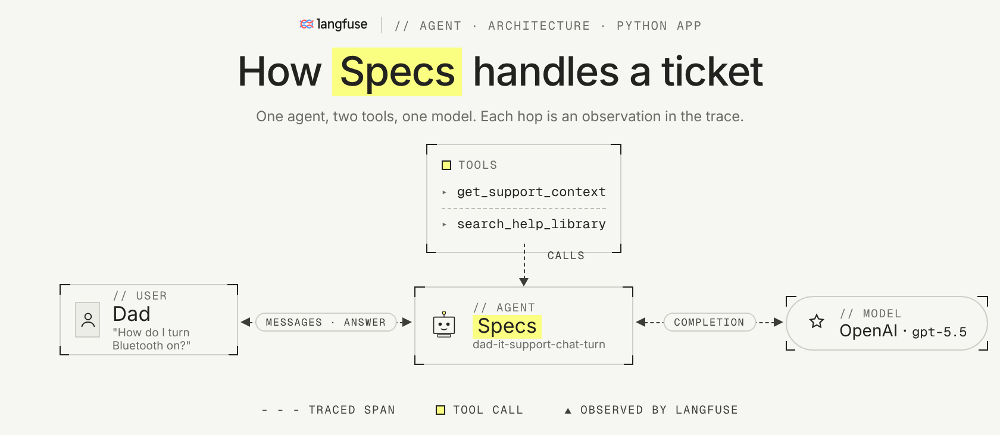
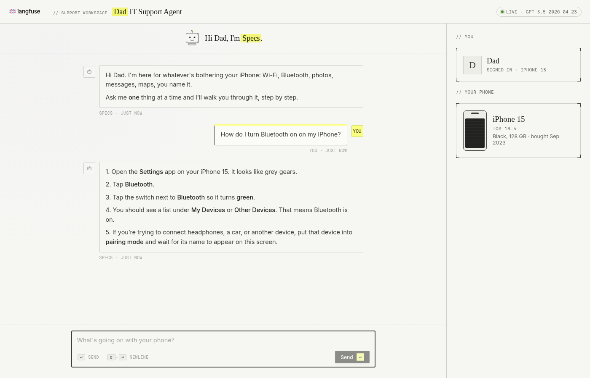

# 00 Setup

## Goal

Have the workshop app running locally with both OpenAI and Langfuse credentials in place. From here you can skim `01-base-app`, then start building in `02-tracing`.

> Use **Langfuse Cloud** so you have the latest features this workshop describes. Self-hosted instances may be on an older version and will not match the lessons.

## Prerequisites

**Python 3.14, installed for you by [uv](https://docs.astral.sh/uv/).** Check uv with `uv --version`. If it is missing:

```bash
curl -LsSf https://astral.sh/uv/install.sh | sh
```

The app itself does not need Node. The Langfuse CLI in the next step is a Node package. Use `npx` so you do not have to install it globally. Install Node `>=22` only if you want that CLI.

**Langfuse AI Features, which include Halo.** New organizations usually have these on unless someone opted out. If [Halo](https://langfuse.com/docs/api-and-data-platform/features/halo) is missing from the project, an organization owner or admin turns AI Features back on under **Organization Settings → General → AI Features**.

## Starting point

```bash
git clone https://github.com/mohdaliiqbal/langfuse-workshop.git
cd langfuse-workshop
uv run python scripts/use_checkpoint.py 00-setup
```

`00-setup` is the same untraced app as `01-base-app` and as the blank slate for `02-tracing`. The TypeScript workshop checks out git tags named `checkpoint/00-setup`. This Python port stores those states in `checkpoints/` and copies the milestone files into `app/`.

The Langfuse keys are configured now, but traces start only after you add instrumentation in `02-tracing`.

## Step 1: Get the API keys

1. **OpenAI**: [platform.openai.com](https://platform.openai.com) → API Keys → create one. Copy the `sk-...` value.
2. **Langfuse**: sign up at [langfuse.com](https://langfuse.com) on the **EU region**, create a project, and copy the public and secret keys from **Settings → API Keys**. If your organization is on another region, use that region's host in `LANGFUSE_BASE_URL`, for example `https://us.cloud.langfuse.com` for US.
3. **AI Features**: confirm Halo is visible in the project. If it is missing, an owner or admin enables **Organization Settings → General → AI Features**.

## Step 2: Install the Langfuse skill and CLI

Later modules drive Langfuse through a coding agent, which needs the `langfuse` skill and the Langfuse CLI.

```bash
npx langfuse-cli --help
npx skills add langfuse/skills --skill "langfuse"
```

`npx` downloads the CLI when you need it. Skip this step if you are following the lessons by hand and do not want a coding agent. The Python app does not import the CLI.

## Step 3: Configure `.env`

```bash
cp .env.example .env
```

Fill in:

```bash
OPENAI_API_KEY=sk-...
LANGFUSE_PUBLIC_KEY=pk-lf-...
LANGFUSE_SECRET_KEY=sk-lf-...
LANGFUSE_BASE_URL=https://cloud.langfuse.com
```

`LANGFUSE_BASE_URL` is the EU host. Change it to your region's host if your project is elsewhere, for example `https://us.cloud.langfuse.com`. Leave the rest of the defaults as they are. `app/env.py` loads this file with override turned on, so a `LANGFUSE_*`, `OPENAI_*`, or `DATASET_NAME` value exported in your shell from another project does not win. Edit `.env` to change the workshop configuration.

Keep real keys in `.env` only.

## Step 4: Install and run

```bash
uv sync
uv run python -m app.server
```

`./setup.sh` does the same `uv sync` and creates `.env` when it is missing.

Leave the server running while you edit. This Python app does not hot-reload. After a code change, stop it with Ctrl+C and start `uv run python -m app.server` again.

Open [http://127.0.0.1:3333](http://127.0.0.1:3333).

## Step 5: Confirm what you see

You should see the **Dad IT Support Agent** chat:

- the Specs mascot up top
- a greeting from Specs
- suggestion chips below the greeting
- the iPhone panel on the right ("Dad" + iPhone 15 details)



## How to verify you are done

- `uv run python -m app.server` is running and the UI loads at `http://127.0.0.1:3333`.
- The browser shows the Specs greeting.
- Sending one suggestion chip returns a real iPhone answer from the model. `GET /api/health` returns `"provider": "openai"`.



## End state

Your environment is ready. Skim `01-base-app` if you want the app tour, then run `uv run python scripts/use_checkpoint.py 02-tracing` before the first code changes. That command is the same snapshot you already loaded.
