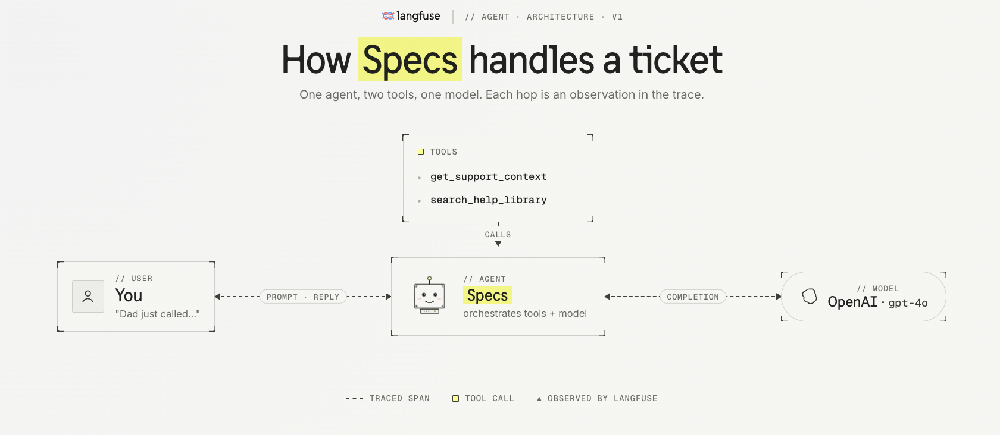

# 01 Base App

> You already cloned the repo and loaded the workshop app in `00-setup`. The base app is that same snapshot, so there is nothing to build in this chapter.

```bash
uv run python scripts/use_checkpoint.py 01-base-app
```

## What the running app does

- Dad himself is the user. Specs (the agent) talks directly to him about his iPhone.
- One OpenAI tool-calling loop. Two local tools (`get_support_context`, `search_help_library`).
- The system prompt is rendered locally from `app/support_agent.py`. No Langfuse yet.



## Where to look in the code

- `app/static/index.html` and `app/static/app.js`: chat UI and side panel. The TypeScript workshop uses React. This port is a small browser page talking to the same `/api/chat` contract.
- `app/server.py`: FastAPI routes. The UI and the API share port **3333**. The TypeScript app splits Vite on 3333 and Express on 8787.
- `app/support_agent.py`: the tool-calling loop you instrument in `02-tracing`.
- `app/tools.py`: tool definitions and `execute_tool(...)`.
- `app/support_data.py`: Dad's fixed context and the guide library.
- `app/support_agent.py`: `SYSTEM_PROMPT`.

## Bonus

You can customize the phone specs in `app/support_data.py`. Putting in a different phone means the replies target that phone.

## End state

You are ready to start `02-tracing`.
