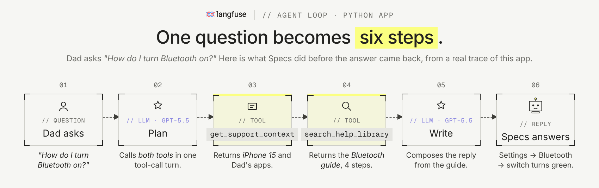
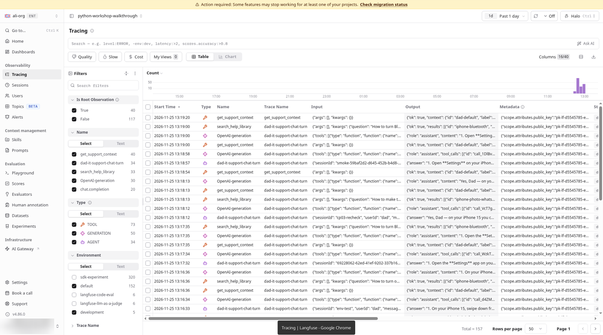
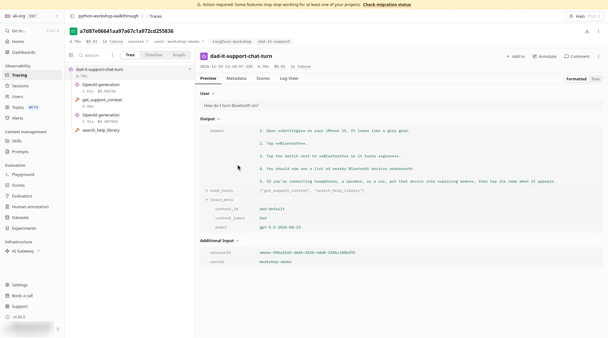

# 02 Tracing

## Why we trace

Tracing logs every step your agent takes. Every model call, every tool invocation, the inputs that went in and the outputs that came back, in the order they happened. It turns the agent from a black box into something you can open up and inspect after the fact, so when an answer is wrong you can point at the exact step where it went wrong.

Complementary materials:

- Docs: [AI Observability and application tracing](https://langfuse.com/docs/observability/overview). SDK options, OpenTelemetry setup, and span attributes.
- Docs: [What does a good trace look like?](https://langfuse.com/docs/observability/best-practices)
- Academy: [Tracing](https://langfuse.com/academy/tracing). Why tracing sits at the start of the AI engineering loop.

## Goal

When Dad asks "How do I turn Bluetooth on?", the agent does not just hit OpenAI once. It asks OpenAI what to do, calls `get_support_context`, asks OpenAI again, calls `search_help_library`, then asks OpenAI once more for the numbered answer. None of that is visible today.

The goal is one nested trace per chat turn: the agent run, the OpenAI generations, and the two tool calls, in order.



1. **First trace**: log the OpenAI generations themselves.
2. **Nested traces**: group the generations under one agent run per turn.
3. **Recording tool calls**: make each tool invocation its own observation.

## Starting point

```bash
uv run python scripts/use_checkpoint.py 02-tracing
```

This is the same untraced code as `01-base-app`. Langfuse is already a dependency in `pyproject.toml`. Run `uv sync` if you have not. `.env` needs `OPENAI_API_KEY` and the Langfuse keys.

The Python SDK starts its own OpenTelemetry exporter. You do not create a `NodeSDK`. `get_client()` is the equivalent of the TypeScript span processor: it reads `LANGFUSE_PUBLIC_KEY`, `LANGFUSE_SECRET_KEY`, and `LANGFUSE_BASE_URL`.

## Step 1: First trace

### `app/server.py`

Boot the client when the process starts, and flush it on the way out so the last trace is not stuck in a buffer.

Near the top:

```python
from contextlib import asynccontextmanager

from app.env import env

_langfuse = None


def _boot_langfuse():
    global _langfuse
    if not env.langfuse_configured:
        return None
    from langfuse import get_client

    _langfuse = get_client()
    return _langfuse


@asynccontextmanager
async def lifespan(_app: FastAPI):
    _boot_langfuse()
    yield
    if _langfuse is not None:
        _langfuse.flush()
        _langfuse.shutdown()
```

Pass `lifespan=lifespan` to `FastAPI(...)`.

### `app/support_agent.py`

Replace the OpenAI import:

```python
from langfuse.openai import OpenAI
```

`from langfuse.openai import OpenAI` is the Python equivalent of `observeOpenAI(new OpenAI(...))`. The call site stays `OpenAI(api_key=env.openai_api_key)`. Every `chat.completions.create(...)` now emits a generation.

Restart the server (`uv run python -m app.server`), ask one question, and refresh Langfuse. You should see one generation per OpenAI call with prompt, response, tokens, and latency. Each generation is still its own top-level trace. The Python SDK names these generations `OpenAI-generation`, which is the name in the screenshot.



## Step 2: Nested traces

Group those generations under one agent run. In Python the wrapper is a decorator, which is the same idea as `observe(fn, { asType: "agent" })` in the TypeScript SDK.

```python
from langfuse import get_client, observe
```

Put the decorator on `run_support_conversation`. Create the OpenAI client **inside** the function so the generations attach to this observation. Add one line at the top that logs the request body as the observation input:

```python
@observe(name="dad-it-support-chat-turn", as_type="agent")
def run_support_conversation(request: ChatRequest) -> ChatResponse:
    get_client().update_current_span(
        input=request.model_dump(mode="json", by_alias=True, exclude_none=True)
    )
    context = get_support_context()
    client = OpenAI(api_key=env.openai_api_key)
    ...
```

`@observe` records the return value as the trace output. On its own it would record the input as `{"args": [...], "kwargs": {}}` with snake_case fields. The `update_current_span` line replaces that with the same `{ sessionId, userId, messages }` body the TypeScript app logs, which is what the evaluators in [4.2 Capturing signals](./04-monitoring/capturing-signals.md) map with **Input → messages**.

Restart, ask one question. One chat turn should now be a single `dad-it-support-chat-turn` observation with the OpenAI generation nested underneath.



## Step 3: Recording tool calls

### `app/tools.py`

```python
from langfuse import observe
```

Decorate the two helpers and keep `execute_tool` calling them:

```python
@observe(name="get_support_context", as_type="tool")
def get_support_context_tool() -> dict:
    ...


@observe(name="search_help_library", as_type="tool")
def search_help_library_tool(question: str) -> dict:
    ...
```

`TOOL_DEFINITIONS` stays untouched. Restart and ask again. The trace should now show both tools.


## How to verify you are done

- A single user turn creates one trace in Langfuse.
- Root observation: `dad-it-support-chat-turn` (type `agent`).
- Child generation from `langfuse.openai.OpenAI` with prompt, response, tokens, and latency.
- Child tool observations: `get_support_context`, `search_help_library`.
- Root input is the chat request body: `sessionId`, `userId`, and `messages`. Root output is the chat response.

## Wrap-up

`@observe(..., as_type=...)` wraps a function and emits a span with the name and type you give it. `from langfuse.openai import OpenAI` is the specialized wrap for the OpenAI SDK.

The [Langfuse skill](https://github.com/langfuse/skills) (`/langfuse`) applies the same patterns without hand-rolling each wrap. This walkthrough exists so you can see what that does.

## Appendix: User and session IDs

The checkpoints after tracing already attach a user and a session, so later chapters can filter without another code step. See [Sessions](https://langfuse.com/docs/observability/features/sessions) and [Users](https://langfuse.com/docs/observability/features/users).

Inside `run_support_conversation`, wrap the tool loop:

```python
from langfuse import propagate_attributes

user_id = request.user_id or f"workshop-{context['id']}"
with propagate_attributes(
    user_id=user_id,
    session_id=request.session_id,
    trace_name="dad-it-support-chat-turn",
    tags=["langfuse-workshop", "dad-it-support"],
):
    client = OpenAI(api_key=env.openai_api_key)
    ...
```

Anything created inside that block, including the OpenAI generations, inherits the user, session, and tags.

## Appendix: Tracing environment

A user and a session say who the turn belongs to. An environment says which deployment sent the trace. Laptop runs and a deployed app land in the same stream, and the dashboards average them together.

Langfuse reads `LANGFUSE_TRACING_ENVIRONMENT` from the process environment. No application code changes. `.env` is loaded before the client starts, so add:

```bash
LANGFUSE_TRACING_ENVIRONMENT=development
```

Restart `uv run python -m app.server`. In the Traces table, filter **Environment** to `development`. A deployed copy of the same project sets the variable to `production`.

The lessons leave this variable unset. Traces then use Langfuse's default environment, and the sample observation in [4.2 Capturing signals](./04-monitoring/capturing-signals.md) can still be filtered to `production` when that panel shows another environment. When you set the variable, filter on the value you set. See [Environments](https://langfuse.com/docs/observability/features/environments).

## End state

The finished traced app is the starting point for `03-prompt-management` and `04-monitoring`. Load it with `uv run python scripts/use_checkpoint.py 03-prompt-management` when you start the next chapter. That snapshot includes tracing and the user/session attributes, and it still uses the local `SYSTEM_PROMPT`.
