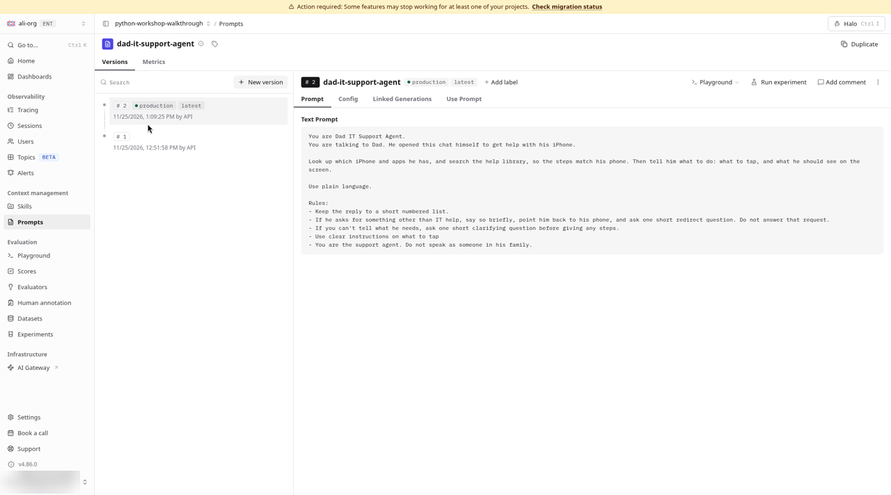
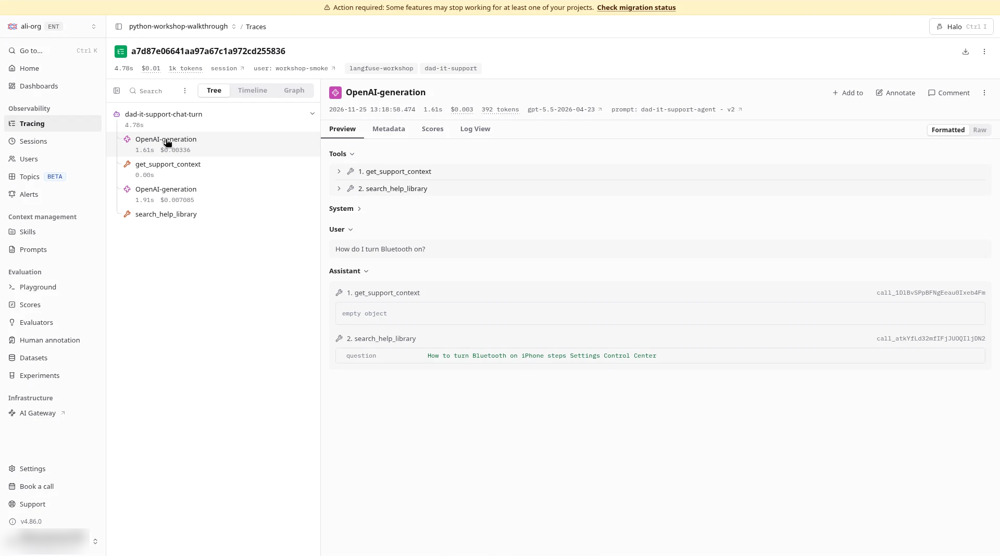

# 03 Prompt Management

## Why manage prompts

Keeping the system prompt in code means every prompt change is a code change: pull request, review, build, deploy. With Langfuse prompt management the prompt lives in Langfuse: versioned, labelled, and editable in the UI, and the app fetches it at request time. Non-engineers can iterate, changes ship without a release, and every version stays linked to the traces it produced.

- Docs: [Prompt management](https://langfuse.com/docs/prompt-management/overview)

## Goal

Have a versioned prompt in Langfuse that the application fetches at request time.

1. **Publish the system prompt to Langfuse.**
2. **Fetch it back at request time**, and link each OpenAI generation to that version.

## Starting point

```bash
uv run python scripts/use_checkpoint.py 03-prompt-management
```

You have a working traced app. `SYSTEM_PROMPT` in `app/support_agent.py` is still the system message. It stays in the file as the fallback when Langfuse is unreachable.

`.env` should contain:

```bash
LANGFUSE_PROMPT_NAME=dad-it-support-agent
LANGFUSE_PROMPT_LABEL=production
```

## Step 1: Publish the prompt (Langfuse UI)

1. In Langfuse, open **Prompts → Create Prompt**.
2. **Name** it `dad-it-support-agent` (this matches `LANGFUSE_PROMPT_NAME`).
3. **Type** is `text`.
4. **Paste** the body of `SYSTEM_PROMPT` from `app/support_agent.py`.
5. **Label** the version `production` (this matches `LANGFUSE_PROMPT_LABEL`).
6. **Save**.



The same publish is available as a script. It reads `SYSTEM_PROMPT` and creates the text prompt with the configured label:

```bash
uv run python scripts/publish_prompt.py
```

## Step 2: Fetch the prompt from Langfuse

In `app/support_agent.py`:

```python
from langfuse import get_client, observe, propagate_attributes


def langfuse_client():
    return get_client()


def get_prompt():
    try:
        prompt = langfuse_client().get_prompt(
            env.langfuse_prompt_name,
            label=env.langfuse_prompt_label,
        )
    except Exception:
        return None
    if not isinstance(getattr(prompt, "prompt", None), str):
        return None
    return prompt
```

Inside `run_support_conversation`, fetch first and fall back to the constant:

```python
langfuse_prompt = get_prompt()
system_prompt = langfuse_prompt.prompt if langfuse_prompt is not None else SYSTEM_PROMPT
```

Send `system_prompt` as the system message. If you leave `SYSTEM_PROMPT` in the transcript, editing the prompt in Langfuse will not change the answers.

`propagate_attributes` still carries the user, session, trace name, and tags. The prompt link is a separate argument on the OpenAI call. In the Python SDK that ships with this workshop (`langfuse` 4.x), pass `langfuse_prompt=` to `chat.completions.create`. That is the equivalent of the TypeScript `observeOpenAI(client, { langfusePrompt })` second argument, and it is what puts the **Prompt** badge on the generation.

```python
with propagate_attributes(
    user_id=user_id,
    session_id=request.session_id,
    trace_name="dad-it-support-chat-turn",
    tags=["langfuse-workshop", "dad-it-support"],
):
    client = OpenAI(api_key=env.openai_api_key)
    response = client.chat.completions.create(
        model=env.openai_model,
        messages=transcript,
        tools=TOOL_DEFINITIONS,
        tool_choice="auto",
        langfuse_prompt=langfuse_prompt,
    )
```

Three things to notice:

- The OpenAI client line did not change. The new piece is `langfuse_prompt=` on `create`.
- `SYSTEM_PROMPT` remains the fallback. A missing prompt does not break the chat. Pass `None` and that turn simply has no Prompt badge.
- `langfuse_prompt` is stripped before the request reaches OpenAI. It is only there for Langfuse.

The finished function is already in `checkpoints/reference/support_agent.py` if you want to compare.

## Verify

Restart `uv run python -m app.server`, ask one question, then in Langfuse:

- Open the trace and the OpenAI generation. It should show a **Prompt** badge linking to `dad-it-support-agent` at the version you published.
- In the Prompts view for `dad-it-support-agent`, the trace shows up where that version was used.



## Wrap-up

Prompt management closes the trace ↔ prompt loop. Every version is preserved, every generation knows which version produced it, and prompt edits do not wait on a code deploy.

## End state

This is the starting point for `04-monitoring`. Restore the finished app before continuing:

```bash
uv run python scripts/use_checkpoint.py 04-monitoring
```
