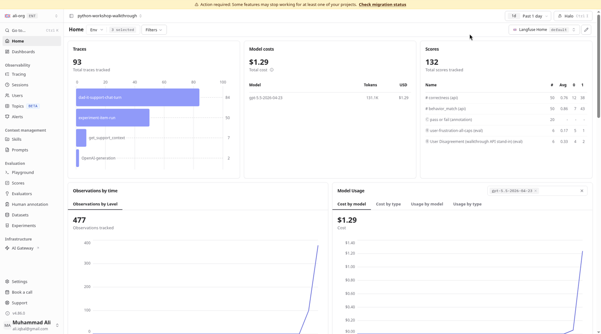
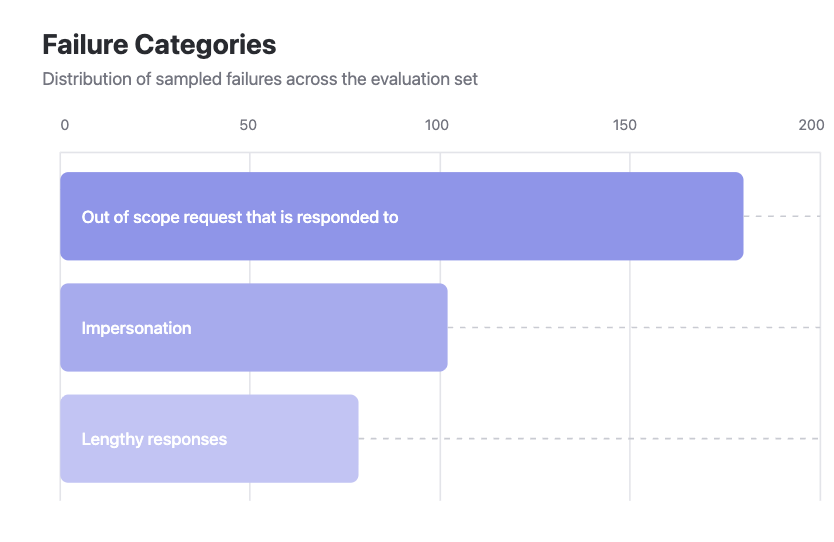
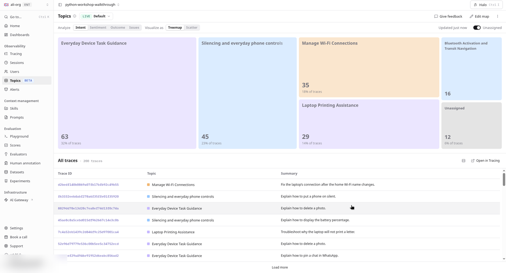
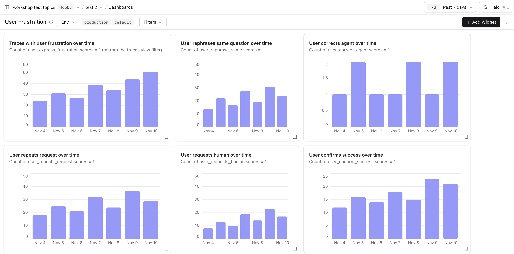

# 04 Monitoring

## Why we monitor

Tracing gives you a record of every step your agent takes. As soon as the system is in production or faces larger scale testing, the volume grows quickly to a point where reviewing every trace one by one and deriving patterns is no longer feasible.

Monitoring is how you look at that tracing data at scale. It covers aggregate metrics and trends over time, approaches to derive failure modes, topics that group traces at scale, and signals that pick out individual executions worth a closer look.

## Ways to work with production traces

### Look at cost, latency, and quality

Cost and latency are logged on every trace. With [dashboards](https://langfuse.com/docs/metrics/features/custom-dashboards) you can build a view on aggregate metrics over time, like spend per model, most used tool calls, and tools that are most likely to fail.



### Do structured error analysis

Error analysis is a structured approach to identify failure modes in your application. People, often domain experts, run it, and it is worth repeating as the application changes.



The Academy page on [error analysis](https://langfuse.com/academy/monitoring/error-analysis) goes deeper.

In [section 4.1 Error analysis](./04-monitoring/error-analysis.md) we run it for the Dad IT Support Agent.

### Detect topics and issues

Error analysis finds failure modes by reading traces. A person does that reading, starting from individual cases. Topics and issue detection is the scaled approach: it groups traces into configurable facets such as intent, sentiment, outcome, and issues. That shows what the system is handling now, and how that changes over time.



In [section 4.2 Detect topics and issues](./04-monitoring/topics.md) we run it for the Dad IT Support Agent.

### Capture signals from users

A signal is something the user does or says that indicates how the turn felt, stored on the trace as a score.

For Specs we start with two conversation signals: whether Dad disagrees with the steps, and whether Dad is writing in all caps.



The Academy page on [capturing signals](https://langfuse.com/academy/monitoring/capturing-signals) maps explicit ratings, behavioral signals, conversation signals, and outcomes.

In [section 4.3 Capturing signals](./04-monitoring/capturing-signals.md) we set those up.

## Starting point

There is no code change on this page. The app should be the finished reference:

```bash
uv run python scripts/use_checkpoint.py 04-monitoring
uv run python -m app.server
```
