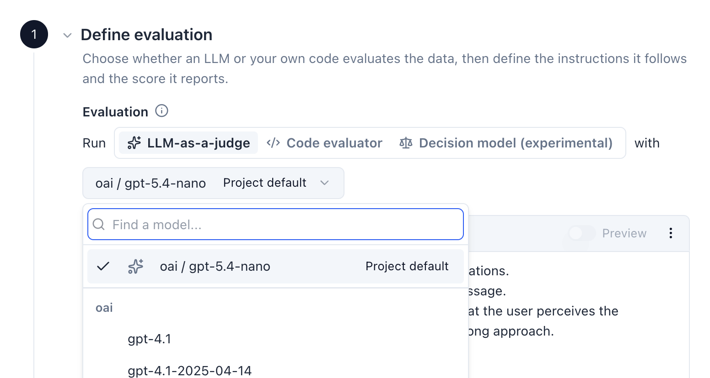
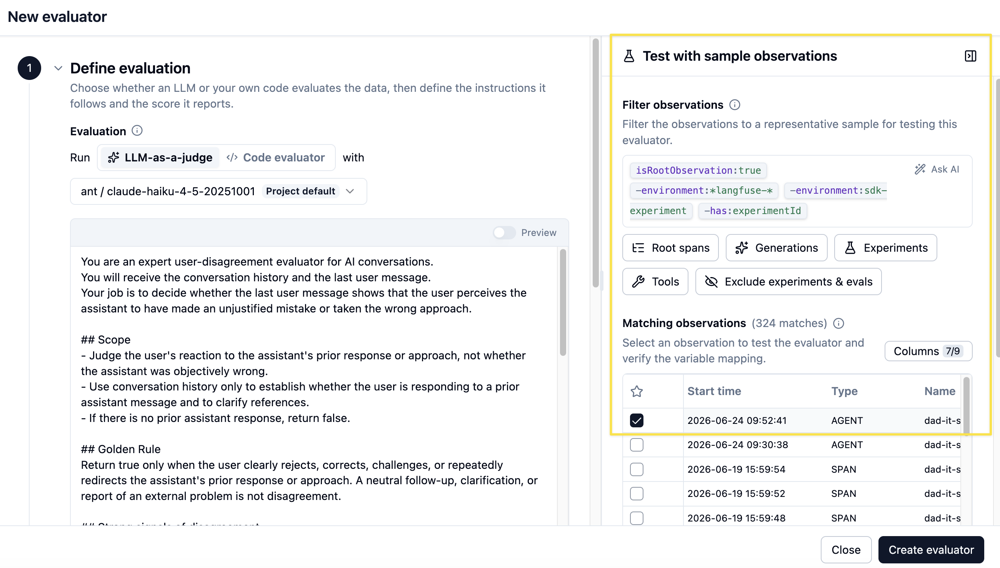
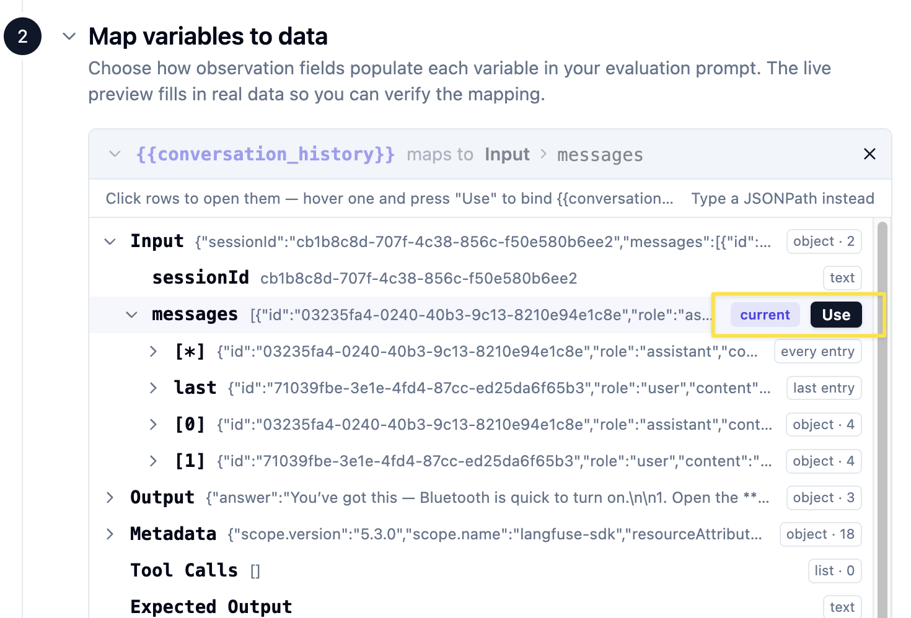
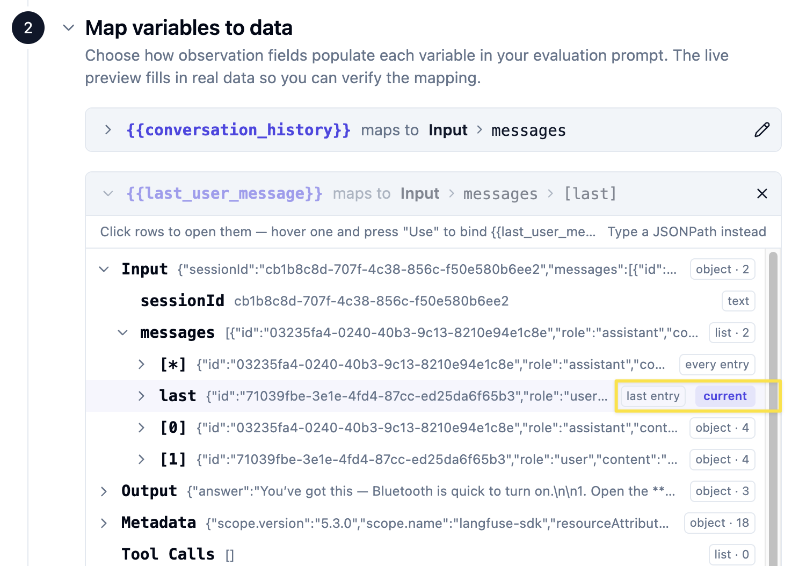
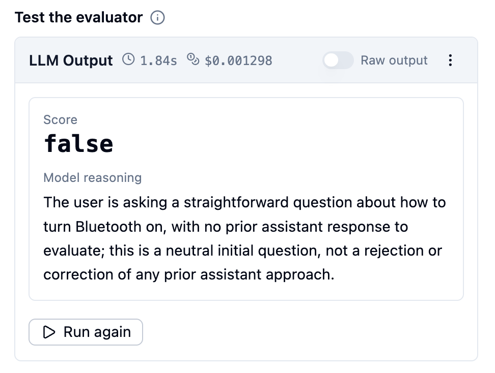
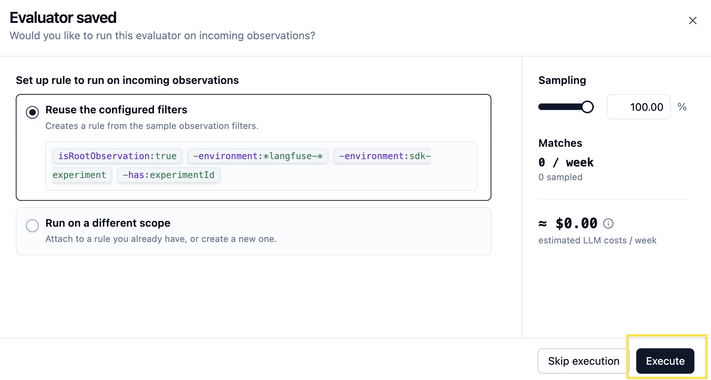
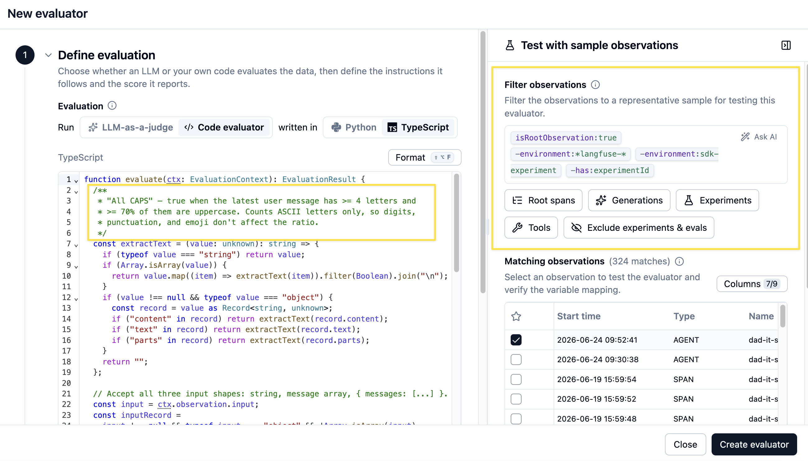
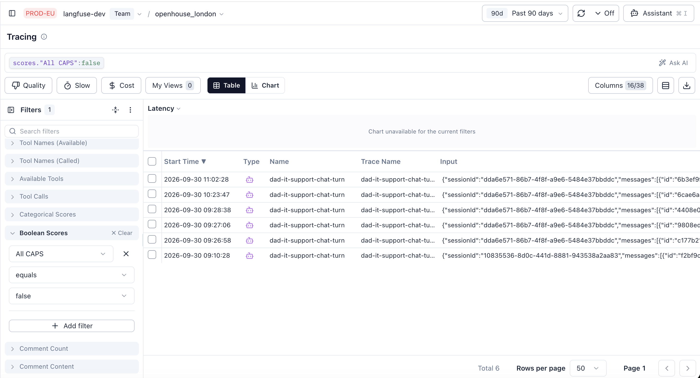
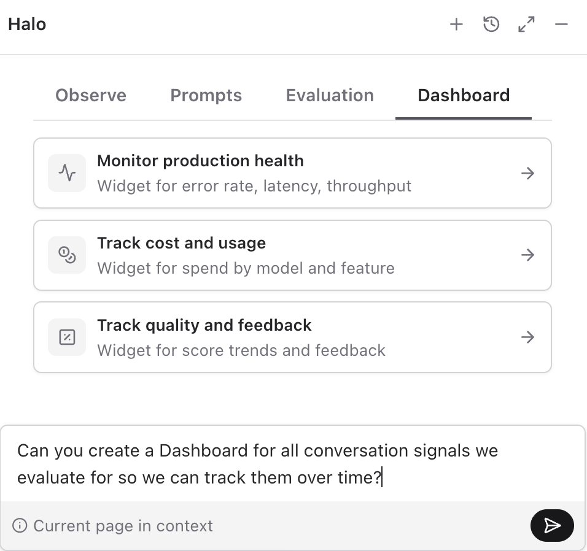
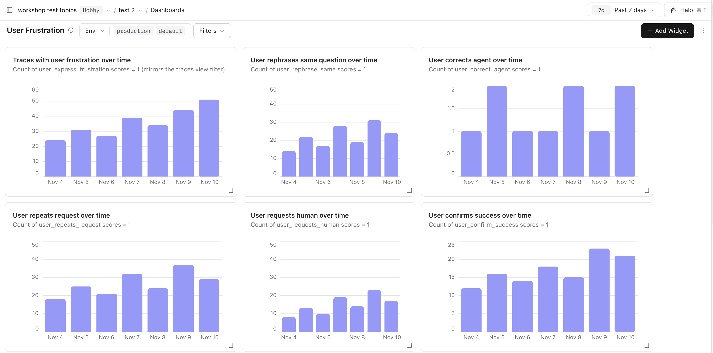

# 4.2 Capturing signals

## Why capture signals

Once traces are coming in, you want a judgment on them without opening each one. A production signal is something the user does or says that shows whether a turn went well. Stored as a score on the trace, it points you to the rows worth reading. Start with the negative ones.

- Docs: [Evaluate production traffic](https://langfuse.com/docs/evaluation/get-started/online)
- Academy: [Capturing signals](https://langfuse.com/academy/monitoring/capturing-signals)

## Goal

Capture two conversation signals for Specs:

- **User disagreement:** Dad pushes back ("No, that menu isn't there").
- **All-caps frustration:** Dad writes something like "THIS STILL ISNT WORKING". A long run of capital letters is a cheap clue that the conversation may need extra attention. It is a triage hint, not proof that Dad is angry.

## Starting point

```bash
uv run python scripts/use_checkpoint.py 04-monitoring
uv run python -m app.server
```

## Step 0: Set up the evaluator model

The disagreement judge needs a model connection on the project. The keys in `.env` do not fill that list.

1. In Langfuse, open **Project Settings → LLM Connections**.
2. Click **Add LLM Connection**.
3. Choose OpenAI, name the connection, and paste your OpenAI API key into the secret field.
4. Save the connection.

When the evaluator wizard asks you to pick a model, choose this connection and **5.6 Luna** (`gpt-5.6-luna`).



## Step 1: Wire the judge-based monitor (Langfuse UI)

Langfuse ships a published **Detect User Disagreement** template. It reads variables from observations.

**Detect User Disagreement** maps `{{conversation_history}}` to every input message and `{{last_user_message}}` to the last input message. Target the root `dad-it-support-chat-turn` agent observation. The Python app logs that same input shape: `messages`, `sessionId`, and `userId`.

1. Open **Evaluators → New Evaluator** and pick **Detect User Disagreement** from the **Template Gallery**.
2. On the right side, select the trace root as a sample observation. Filter to the `production` environment if the panel is showing something else.

   

3. Under **Map variables to data**, bind each variable from the live observation tree. Open a row, hover the field, and press **Use**. Do not use **Type a JSONPath instead**.

   - `{{conversation_history}}`: open **Input**, hover **messages**, and press **Use**. The binding reads **Input → messages**.
   - `{{last_user_message}}`: open **Input → messages**, hover **last**, and press **Use**. The binding reads **Input → messages → last**.

   

   

4. Test the evaluator on the sample observation.

   

5. Click **Create evaluator**. Review the cost estimate and sampling rate, then click **Execute**.

   

The rule scores observations that arrive after you execute it. The seeded batch is the sample for mapping and testing. New turns receive the live score. Historical observations can be scored with [batch evaluation](https://langfuse.com/docs/evaluation/get-started/online).

## Step 2: Add a code evaluator for all-caps frustration

This check does not need a model. It looks for a user message that is mostly capital letters.

1. Open **Evaluators → New Evaluator** and pick **Detect User Frustration (ALL CAPS)**. The template targets the input of an observation and checks whether more than 70% of a message is capital letters.
2. Target the same root agent observation:

   

3. Run a test.
4. Click **Create Evaluator**, then **Execute**.

This evaluator runs as TypeScript inside Langfuse's sandbox. The Python app does not run that code. The sandbox only sees the observation input, which is the same messages array either SDK would log.

## Step 3: Verify the monitors

With the server running, send two new turns after both evaluators are executing:

1. **Disagreement**: ask a normal question, then reply with "No, that menu isn't there"
2. **All caps**: "THIS STILL ISNT WORKING"

In Langfuse, wait a few seconds, then filter Tracing by the evaluator score.



You can ask Halo to turn the scores into a dashboard. Stay on a page Halo can use as context, open the **Dashboard** tab, and ask it to chart the signals.





User disagreement is a high-signal event. These traces are prime candidates for dataset items in [05 Build eval datasets](../05-dataset.md).

## Bonus: Conversation signals with decision models

A [decision model](https://langfuse.com/docs/evaluation/evaluation-methods/decision-models) returns a typed answer instead of free-form text.

1. Go to the evaluator library.
2. Select **Detect conversation signals**.
3. Test it on one or two examples.
4. Save.

## End state

This is the starting point for [05 Build eval datasets](../05-dataset.md).
