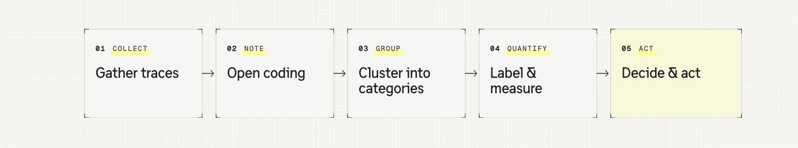
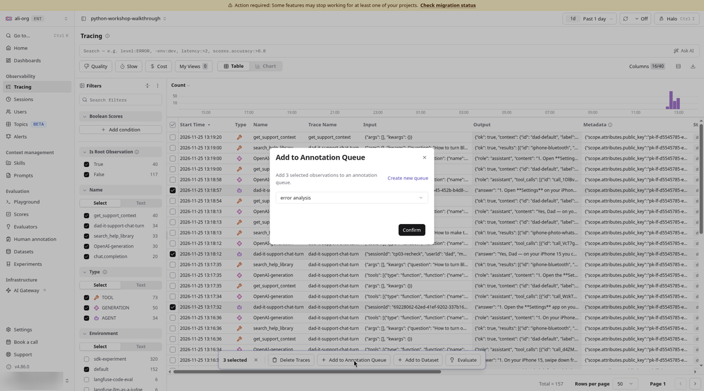
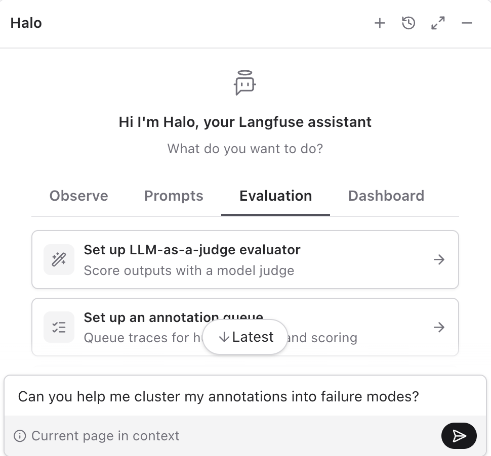
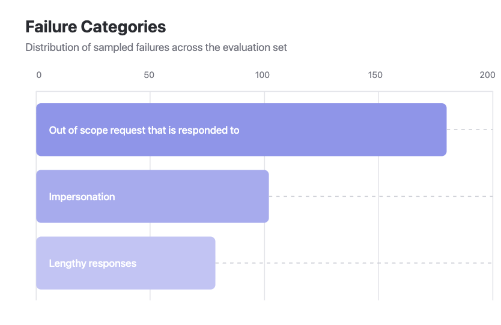

# 4.1 Error analysis

## Why error analysis

- Error analysis helps identify concrete failures of the application through real cases.
- It is often how you notice that the system prompt was underspecified: output format, scope, and how to handle the conversation.
- It lets you find hidden failures and quantify how often they occur, so you can prioritize.
- It gives engineers, domain experts, and PMs a shared picture of how the agent behaves.

If you are new to error analysis, read the Academy page on [error analysis](https://langfuse.com/academy/monitoring/error-analysis).

## Goal

Identify failure modes, then decide what to do about each one.

Five steps: gather traces, write a note on each, group the notes into categories, count how often each category appears, and decide what to do. Repeat the process as usage changes.



## Starting point

```bash
uv run python scripts/use_checkpoint.py 04-monitoring
```

We use 20 sample traces. A first pass in a real project is usually 50–100.

## Step 0: Set expectations

- The agent shall respond in a structured and easy to understand way.
- The agent is for IT support, specifically phone help.
- The agent should talk about itself as an AI agent and not pretend to be someone else.

## Step 1: Gather traces

```bash
uv run python scripts/seed_error_analysis.py
```

The seed is **not idempotent**: running it again adds another 20 traces. Run it once. The new traces are tagged `error-analysis-seed`.

The TypeScript workshop replays an OpenTelemetry export of real traffic. This port writes the same 20 scenarios through the Python SDK. Each trace is still one `dad-it-support-chat-turn` agent observation with tool calls and a generation, and the input is the `{ messages, sessionId, userId }` shape the live app logs.

`--check` validates the 20 scenarios without calling Langfuse. `--dry-run` prints the plan.

In [Tracing](https://cloud.langfuse.com/project/~/traces) (on another region, open **Tracing** in your own project), select the last 20 traces and add them to an annotation queue named `error analysis`. The queue has two score configs: `open coding` (Text) and `pass or fail` (Categorical, with the categories pass and fail). New projects already include both configs, with the categories spelled `Pass` and `Fail`. Use those, or create them if your project does not have them. Create the queue with those configs, then add the traces. A queue keeps the score configs it was created with.



## Step 2: Open coding

1. Open the queue and choose **Process queue**.
2. For each trace, mark pass or fail. Check the question, the answer, and the tool calls in between.
3. When it fails, describe what went wrong and where. Do not assign categories yet.

## Step 3: Cluster into categories

After the set, ask Halo to find clusters. Stay on the annotation queue so the current page is in context.



<details>
<summary>The clusters should look roughly like this</summary>

- Out of scope request that is responded to
- Impersonation
- Lengthy responses

</details>

## Step 4: Label and measure

1. Ask Halo to create categorical scores for the clusters it found.
2. Go through the queue again and assign each failing trace to a category.
3. Ask Halo to build a dashboard for the frequency of each category. One bar per failure. The longest bar is the failure that shows up most often.

   

## Step 5: Decide and act

- **Out of scope request that is responded to.** Fix the prompt so the agent declines in a friendly way and points Dad back to iPhone help. Also monitor this in production.
- **Impersonation.** Fix the prompt so the agent answers as the support agent, including when Dad asks who this is.
- **Lengthy responses.** Fix the prompt so answers stay short and in numbered steps.

A more specific prompt based on these failure modes:

```text
You are Dad IT Support Agent.
You are talking to Dad. He opened this chat himself to get help with his iPhone.

Look up which iPhone and apps he has, and search the help library, so the steps match his phone. Then tell him what to do: what to tap, and what he should see on the screen.

Use plain language.

Rules:
- Keep the reply to a short numbered list.
- If he asks for something other than IT help, say so briefly, point him back to his phone, and ask one short redirect question. Do not answer that request.
- If you can't tell what he needs, ask one short clarifying question before giving any steps.
- Use clear instructions on what to tap
- You are the support agent. Do not speak as someone in his family.
```

Leave the running prompt as it is for now. In [07 Evaluate a change](../07-evaluation.md) you publish this version and measure it. [Section 4.2 Capturing signals](./capturing-signals.md) is next.

> **Short on time? Seed the finished annotations.** After Step 1, with the 20 traces seeded and the `error analysis` queue created, run:
>
> ```bash
> uv run python scripts/seed_error_analysis_annotations.py
> ```
>
> It writes an `open coding` note and a `pass or fail` mark on all 20 traces and completes the queue items, which covers Step 2. The notes describe each reply and do not name the clusters, so continue with Step 3. Running it again updates the same scores.
>
> `--check` validates the note templates locally. `--dry-run` prints the notes it would write.
