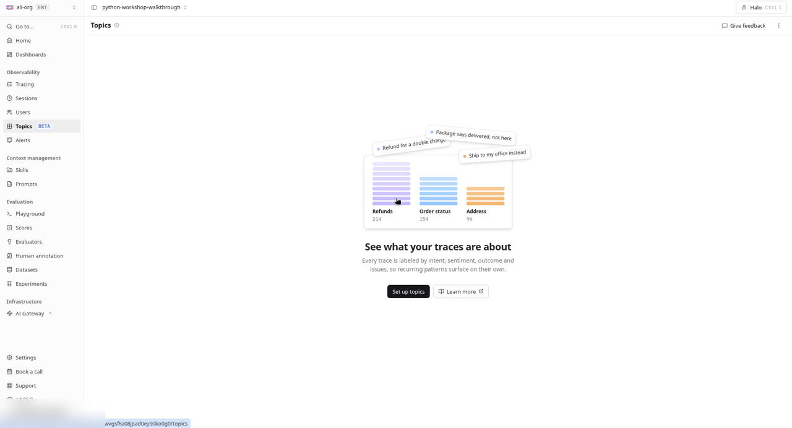
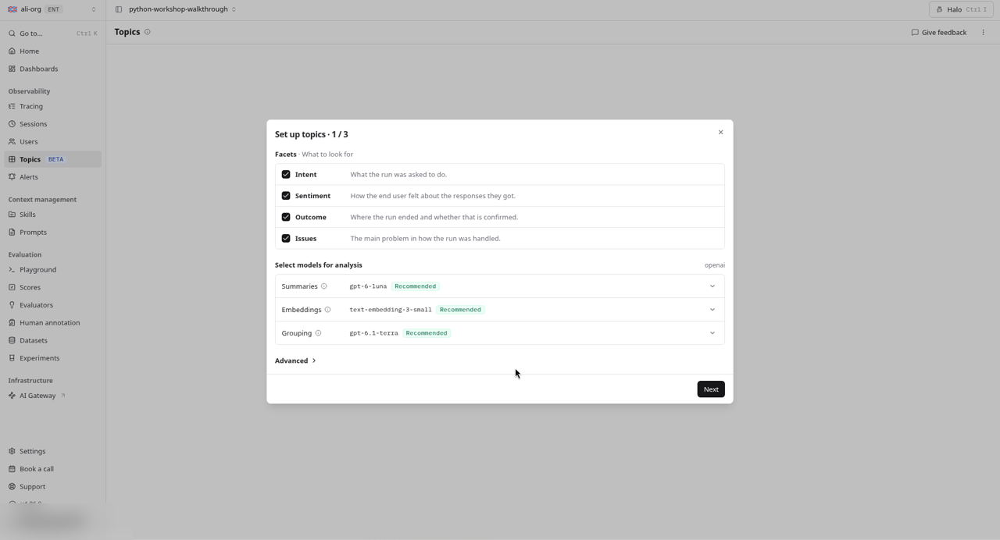
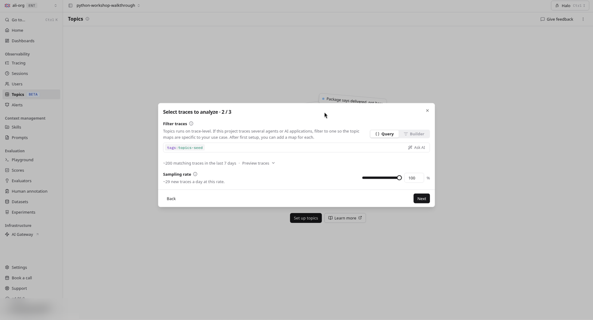
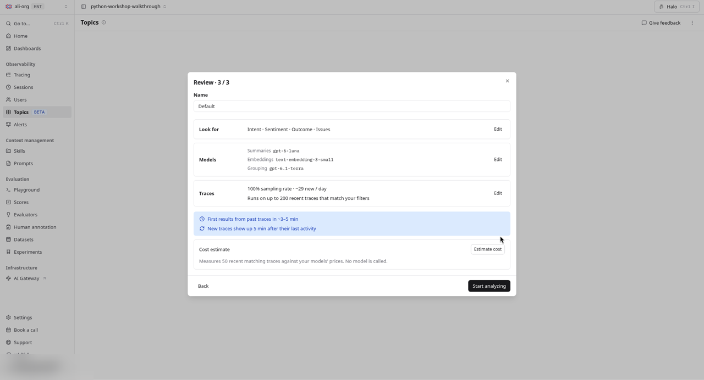
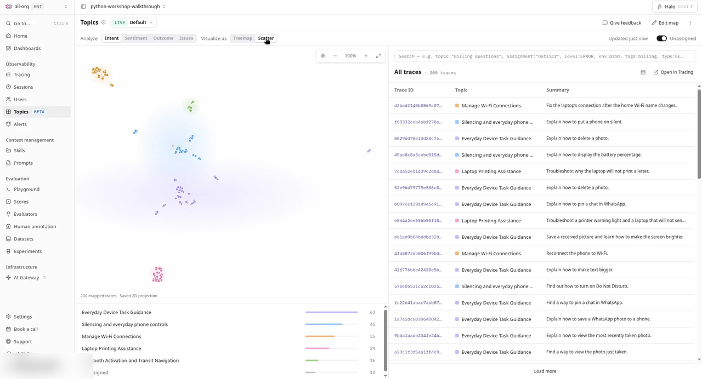
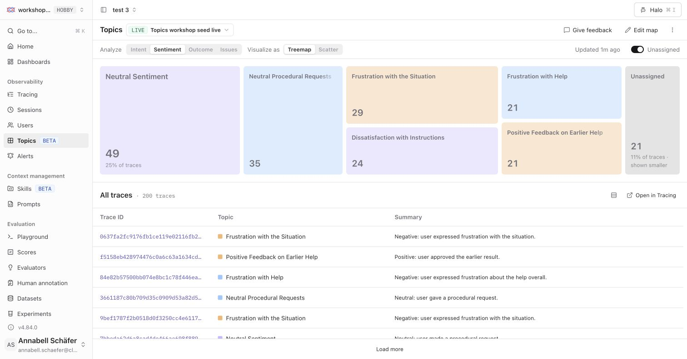
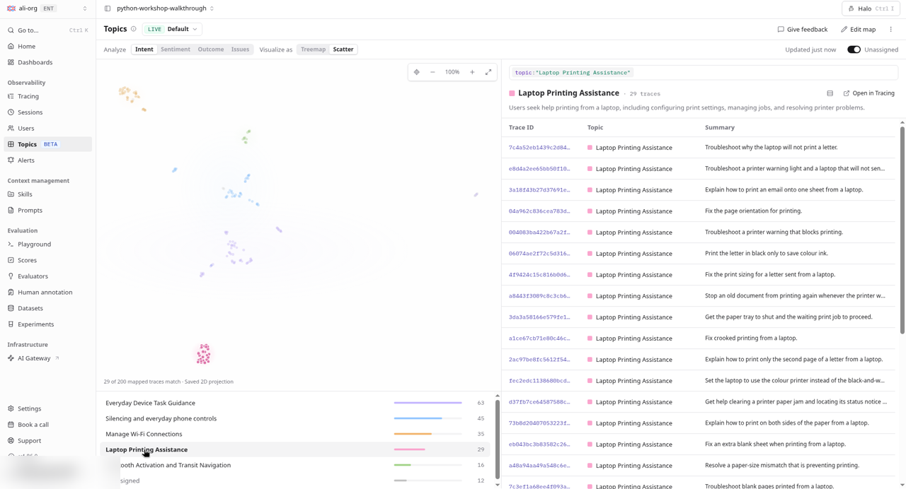
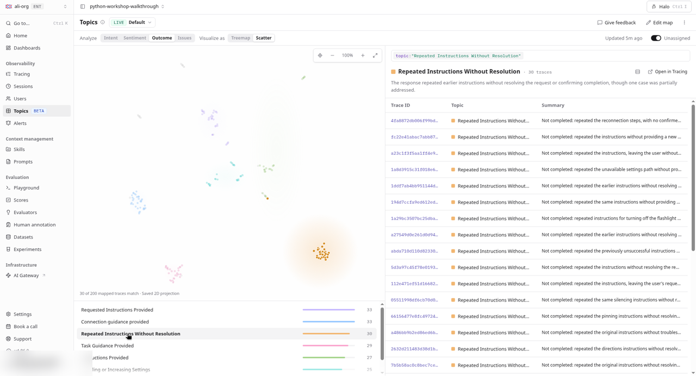
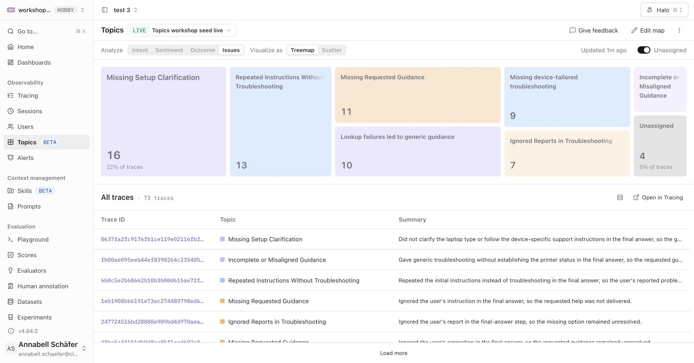

# 4.2 Detect topics and issues

## Why topics and issue detection

Topics turns trace-level data into a map of what your agent handles, where runs end, and what goes wrong. It is useful when the trace volume is too large to read one by one.

The map is a starting point for questions such as:

- Which requests are we handling in production?
- Which groups suggest an opportunity to expand the product?
- Which recurring issues should become prompt changes, tools, or evaluators?

Topic names come from a model after the groups form. Your result will be close to the examples in this lesson, and it will not be identical.

## Goal

Configure a topic map for 200 sample traces, then read the groups for what Specs is asked to do, how Dad feels, and where the handling goes wrong.

## Starting point

```bash
uv run python scripts/use_checkpoint.py 04-monitoring
```

## Step 1: Seed the traces

```bash
uv run python scripts/seed_topics_traces.py
```

The seed is **not idempotent**. OpenTelemetry mints fresh trace IDs on every run, so re-running doubles the data. Run it once. If you need a clean slate, delete the prior seed traces in Langfuse before seeding again. The new traces are tagged `topics-seed`.

The TypeScript workshop replays an OpenTelemetry export with shifted timestamps. This port sends the same 200 scenarios, in the same order, to the Langfuse OpenTelemetry endpoint with explicit start times: 36 minutes apart, about five days in all, with the newest about 10 minutes old. Each trace is still one `dad-it-support-chat-turn` agent observation with the two tool calls and a generation, and the input is the `{ messages, sessionId, userId }` shape the live app logs. `--check` validates the scenarios and `--dry-run` builds every trace in memory without calling Langfuse.

Open [Tracing](https://cloud.langfuse.com/project/~/traces) if you want to inspect the seeded traces first. Then open [Topics](https://cloud.langfuse.com/project/~/topics). On another region, open **Tracing** and **Topics** in your own project.

## Step 2: Add the model connection

Topics needs an LLM connection in the project. Add an OpenAI connection before editing the map. [Section 4.3 Capturing signals](./capturing-signals.md) uses this same connection.

1. In Langfuse, open **Project Settings → LLM Connections**.
2. Click **Add LLM Connection**.
3. Choose OpenAI, name the connection, and paste your OpenAI API key into the secret field.
4. Save the connection.

If a connection is already there, keep it and continue.

Keep the API key in the Langfuse secret field only. Do not paste it into workshop transcripts or shared notes.

## Step 3: Set up topics from the empty state

On a new project, Topics opens with **See what your traces are about** and a **Set up topics** button. Start there. The first-run setup is a three-step wizard; after the map exists, use **Edit map** to change the same settings.



1. Click **Set up topics**. The dialog title is **Set up topics · 1/3**. Under **Facets · What to look for**, leave all four facets checked:

   - **Intent:** What the run was asked to do.
   - **Sentiment:** How the end user felt about the responses they got.
   - **Outcome:** Where the run ended and whether that is confirmed.
   - **Issues:** The main problem in how the run was handled.

   A project may have a different selection, so do not assume that every facet is present in every map.

   Under **Select models for analysis**, keep the recommended models: `gpt-6-luna` for summaries, `text-embedding-3-small` for embeddings, and `gpt-6.1-terra` for grouping. Click **Next**.

   

2. The next dialog is **Select traces to analyze · 2/3**. Use **Query** or **Builder** to limit the map to the traces for this app. Topics runs on trace-level data. If the project contains several agents or applications, filtering keeps them from being mixed into one map. For this workshop, enter `tags:topics-seed` in **Query** so the map contains the Topics seed. In a clean project where these are the only traces, an empty filter produces the same set.

   The panel then reports about **200 matching traces in the last 7 days**. Leave the **Sampling rate** at `100%` (about 29 new traces a day at that rate). New traces can take about 5 minutes after their last activity to become eligible; the seed timestamps its newest trace more than 5 minutes in the past.

   

   Click **Next**.

3. The last dialog is **Review · 3/3**. The name field reads **Default**. Confirm **Look for** lists Intent, Sentiment, Outcome, and Issues, the three models, and `100% sampling rate · ~29 new / day`. Under **Traces**, the review says **Runs on up to 200 recent traces that match your filters**. It also says first results from past traces take about 3–5 minutes, and new traces show up 5 minutes after their last activity. **Estimate cost** is optional. It prices 50 recent matching traces and does not call a model.

   Topics needs about 100 traces to form stable groups, so a smaller batch may take longer. If the project contains traces from more than this workshop, the first result can include those traces too; use a trace filter when you need an app-specific map.

   

   Click **Start analyzing**. The analysis runs in the background. In this walkthrough the Intent and Outcome groups were ready in about 2.5 minutes. New traces appear about 5 minutes after their last activity.

After the first map exists, **Edit map** opens these settings again. Use it to rename the map, change facets or filters, toggle **Live updates**, or adjust the sampling rate. The Intent and Outcome screenshots in this lesson are that run: a map named **Default**, filtered with `tags:topics-seed`, showing 200 traces. Topic names are model-generated and will vary from run to run. Sentiment and Issues can take longer. In this run both still said **Not enough analyzed traces yet** after more than 15 minutes, so those screenshots are from the upstream workshop.

If the map is marked **PAUSED**, it is not analyzing new traces. The header status tells you whether the selected map is active. The map selector can contain more than one map.

## Step 4: Explore the map

When analysis is ready, choose a facet from the tabs under **Analyze**. Only enabled facets appear. Choose **Treemap** for a size-based overview or **Scatter** for an embedding view of the groups.

The **Unassigned** toggle controls whether traces without a topic are included. The tiles show model-generated names, counts, and percentages. Click a tile to see the matching traces and their summaries. **Open in Tracing** takes you to the corresponding trace list.


On **Scatter**, inspect the groups and the trace list together. You can search the results with filters such as an assignment or topic, then open the matching traces in Tracing.



On **Issues** and **Sentiment**, open a group and read several traces before calling it a failure. A model-generated label can be too broad, can overlap with an intent, or can describe a symptom rather than the cause. Those two facets were not ready in the Python walkthrough. Both showed **Not enough analyzed traces yet**. The screenshots below are the upstream workshop's populated views, so the tile names will not match a later run of this project.




## Step 5: Apply the map to the Dad IT Support Agent

Walk through the enabled facets before choosing a fix. Intent shows the kinds of help Dad requested. Sentiment shows how conversations felt. Outcome shows where they ended. Issues shows recurring problems in the handling. Some groups will show the agent working as expected. Topics are a map of use, including the requests that succeed.

Topic names are model-generated and will vary per run. The Intent and Outcome names below are one run of this seed in `python-workshop-walkthrough`. The Sentiment and Issues names are the upstream capture, because those facets had not populated here. Treat every label as a hypothesis: open representative traces, decide what the group means, and then turn the useful patterns into prompt changes, tools, or evaluators.

### Insight 1: Laptop help is a chance to widen what Specs supports

On **Intent**, this run produced six groups:

- Everyday Device Task Guidance, 63
- Silencing and everyday phone controls, 45
- Manage Wi-Fi Connections, 35
- Laptop Printing Assistance, 29
- Bluetooth Activation and Transit Navigation, 16
- Unassigned, 12

Open **Laptop Printing Assistance** (29 traces). The summaries are print settings, paper jams, and a laptop that will not print.



The iPhone is the device Specs is built for. These printing requests sit outside that, and Specs answers them anyway. Open several traces. The answer does not ask which laptop Dad has. It hedges every time: if it is Windows, do this; if it is a Mac, do this. Laptop Wi-Fi requests sit in **Manage Wi-Fi Connections** (35) beside phone Wi-Fi, and those answers hedge the same way.

The agent is trying to be helpful, and it is missing the context it needs. This is a context problem, and we can provide that context through the `get_support_context` tool. `DEFAULT_SUPPORT_CONTEXT` in `app/support_data.py` already lists Dad's iPhone under `devices`, and that is what the tool returns. Add the laptop there, next to the phone. Specs can then give the steps for that machine.

A tile summary may describe these replies as unsupported and suggest sending Dad back to iPhone help. Read the traces before taking that suggestion. Specs is already trying to help. Telling it which laptop Dad uses makes those answers specific.

The prompt still names only the iPhone. A more specific prompt version based on these laptop requests could look like this:

> You are Dad IT Support Agent.
> You are talking to Dad. He opened this chat himself to get help with his phone and his laptop.
>
> Look up which phone and laptop he has, and search the help library, so the steps match that device. Then tell him what to do: what to tap, and what he should see on the screen.
>
> Use plain language.
>
> Rules:
> - Keep the reply to a short numbered list.
> - If he asks for something other than IT help, say so briefly, point him back to his phone or his laptop, and ask one short redirect question. Do not answer that request.
> - If you can't tell what he needs, ask one short clarifying question before giving any steps.
> - Use clear instructions on what to tap
> - You are the support agent. Do not speak as someone in his family.

Leave the running prompt as it is for now. The laptop belongs in the prompt because Dad is already asking about it. The prompt you publish in [07 Evaluate a change](../07-evaluation.md) is the one from [section 4.1 Error analysis](./error-analysis.md), which still points non-IT requests back to his phone.

### Insight 2: Sentiment shows the frustration

Sentiment was not ready in this Python run. The tab showed **Not enough analyzed traces yet** for more than 15 minutes, so the screenshot is the upstream workshop's Sentiment treemap. Names will differ when your facet fills in.

On that capture, the largest groups are still calm: **Neutral Sentiment** (49) and **Neutral Procedural Requests** (35). Frustration does not land as one block. It splits across **Frustration with the Situation** (29), **Dissatisfaction with Instructions** (24), and **Frustration with Help** (21). **Positive Feedback on Earlier Help** (21) is the other named group.

Open a frustration group. The summaries on that capture say the user was negative about the situation, the instructions, or the help.

A few messages are in all caps, such as "THIS STILL ISNT WORKING", and a few push back: "No, that menu isn't there." [Section 4.3 Capturing signals](./capturing-signals.md) is next, and it turns this feeling into two scores: Dad disagreeing with the steps, and Dad writing in all caps.


### Insight 3: Repeated steps after Dad says they failed

On **Outcome**, this run's group **Repeated Instructions Without Resolution** holds 30 traces. The description says the response repeated earlier instructions without resolving the request or confirming completion. That count matches the 30 stuck follow-ups in the seed.

These are the two- and three-turn sessions where Dad says the steps did not work ("I did that, but nothing changed" or "I can't find that option") and Specs sends the same numbered list again. They hide inside ordinary intents such as Bluetooth or WhatsApp, which is why they show up together here.

The other Outcome groups in this run are Requested Instructions Provided (33), Connection guidance provided (33), Task Guidance Provided (29), Instructions Provided (27), and Enabling or Increasing Settings (25), plus Unassigned.



The fix could live in the system prompt: when Dad says a step failed, ask what he sees on screen and try a different path.

### Insight 4: A search that looks wrong, and an answer that still works

Issues was not ready in this Python run either. The screenshot is the upstream workshop's Issues treemap. One of its groups is **Lookup failures led to generic guidance** (10 traces): the help-library lookup does not match the request, and the final answer is still generic.

Open a few traces. The help-library query or result may be unrelated, and the final answer can still be useful. Leave this tile for a later look at the library. How often does `search_help_library` actually help, and which requests does it have nothing useful for? Look at the guides in `app/support_data.py` before treating the tile as a broken answer.



Read enough traces to decide whether the group is a prompt problem, a tool problem, or missing library content. Halo can help with that reading. From the Topics page, ask it to open a group, point at the step in the trace that led to the issue, and flag tiles that look like false positives.

[Section 4.3 Capturing signals](./capturing-signals.md) is next. It turns the frustration and disagreement patterns into production signals.
