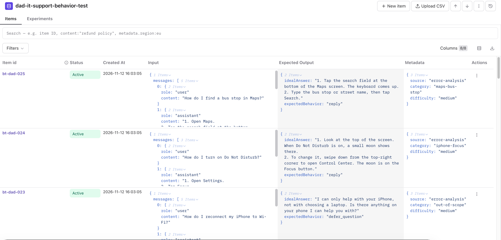

# 05 Build eval datasets

## Why build datasets

A dataset is your representation of what the system will face in production: the inputs you expect, and for each, what a good answer looks like. With expectations written down, you can rerun the agent after every change and know whether you helped or hurt.

- Docs: [Datasets](https://langfuse.com/docs/evaluation/experiments/datasets)
- Academy: [Datasets](https://langfuse.com/academy/datasets)

## Goal

Create a first eval dataset that captures the kinds of requests Specs has to handle.

1. **Decide on the goal.**
2. **Design the item shape.**
3. **Seed the hosted dataset.**

## Starting point

```bash
uv run python scripts/use_checkpoint.py 05-dataset
```

`data/seed-dataset.json` and `scripts/seed_dataset.py` are already in the repo. `.env` should contain:

```bash
DATASET_NAME=dad-it-support-workshop
```

## Step 1: Decide on the goal for your eval dataset

For Specs, two things matter most:

- **The answers are correct.**
- **The agent behaves appropriately**: it knows when to reply, when to defer a question, and when to ask a follow-up first. Error analysis showed that out-of-scope requests often get answered anyway.

The starter dataset has 25 items. Nine come from the traces you reviewed in [4.1 Error analysis](./04-monitoring/error-analysis.md) (`"source": "error-analysis"`). The other 16 cover cases it did not include (`"source": "starter"`). Together they cover iPhone how-to questions, out-of-scope requests, multi-turn conversations, limits the agent must state, and vague requests that need a clarifying question.

## Step 2: Design the item shape

| Field | Required | Purpose |
| --- | --- | --- |
| `input` | yes | What you feed the agent. For us, the same `{ messages: [...] }` shape `/api/chat` accepts. |
| `expectedOutput` | optional | What a good answer looks like. |
| `metadata` | optional | Tags for filtering (`category`, `difficulty`, `source`). |

One item, conceptually:

```json
{
  "input": "How do I turn Bluetooth on on my iPhone?",
  "expectedOutput": {
    "idealAnswer": "1. Open the Settings app.\n2. Tap Bluetooth.\n3. Turn the Bluetooth switch on. It turns green when Bluetooth is on.",
    "expectedBehavior": "reply"
  },
  "metadata": { "category": "iphone-bluetooth", "difficulty": "easy", "source": "starter" }
}
```

- **`idealAnswer`**: is the answer correct?
- **`expectedBehavior`**: one of `reply`, `defer_question`, or `ask_follow_up`.

On disk, `input` is the full `{ "messages": [...] }` object, plus an `id` for the row. Multi-turn items carry the earlier turns in that array. `scripts/run_dataset.py` feeds that object to `run_support_conversation(...)`.

## Step 3: Seed the dataset

```bash
uv run python scripts/seed_dataset.py
```

Open Langfuse → **Datasets**. The list should show `dad-it-support-workshop` with 25 items.



## How to verify you are done

- The dataset shows up in Langfuse with all 25 items.
- Item inputs look like the `messages` array a real chat turn would have.
- You can name the failure modes the dataset covers.

## End state

This is the starting point for `06-experiments`.
