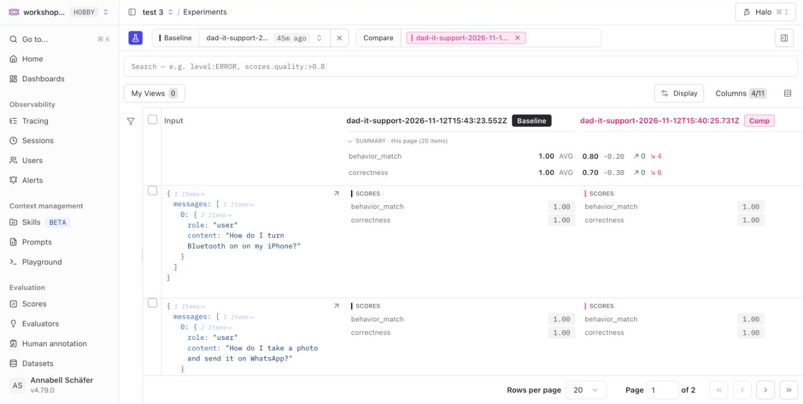

# 07 Evaluate a change

## Why evaluate changes with experiments

If you change a prompt, a model, the context you pass, or the agent architecture, you want to know whether the change made the system better. Rerunning the same dataset and comparing scores is the measurement. When the new run's averages go up, and you have read enough items to trust the score, you have evidence to ship.

- Docs: [Evaluation overview](https://langfuse.com/docs/evaluation/overview)
- Academy: [Evaluate](https://langfuse.com/academy/evaluate)

## Goal

Publish the prompt suggested by error analysis, rerun the dataset, and compare `behavior_match` and `correctness`.

1. **Change one thing**: publish the error-analysis prompt as a new version.
2. **Rerun the dataset.**
3. **Compare runs** and decide whether to ship.

## Starting point

```bash
uv run python scripts/use_checkpoint.py 07-evaluation
```

You need at least one experiment run with both scores. That run is the baseline: it used the production `dad-it-support-agent` prompt. Open the dataset → **Experiments** and read the averages, then open items where either score is low.

## Step 0: Choose the lever to change

This chapter changes the prompt because that is the lowest-friction lever. The same workflow applies to the model, the context, or the agent architecture. Change one thing, rerun, compare.

## Step 1: Change the prompt

| Failure | Prompt rule | Baseline behavior it targets | Checked by |
| --- | --- | --- | --- |
| Out of scope | Decline anything that is not IT help, and ask one short redirect question. | `defer_question` items answered as recipes, savings, or pasta | `behavior_match` |
| Vague requests | Ask one clarifying question before giving steps. | `ask_follow_up` items answered immediately | `behavior_match` |
| Lengthy responses | Keep the reply to a short numbered list. | Long unstructured replies | Read a few answers |
| Impersonation | Do not speak as someone in his family. | Replies in a family voice | Read a few answers |

**Option A: Langfuse UI (recommended).** Prompts → `dad-it-support-agent` → new version → paste the prompt below → save → move the `production` label to the new version. The app fetches by label, so the next request uses it.

```text
You are Dad IT Support Agent.
You are talking to Dad. He opened this chat himself to get help with his iPhone.

Look up which iPhone and apps he has, and search the help library, so the steps match his phone. Then tell him what to do: what to tap, and what he should see on the screen.

Use plain language.

Rules:
- Keep the reply to a short numbered list.
- If he asks for something other than IT help, say so briefly, point him back to his phone, and ask one short redirect question. Do not answer that request.
- If you can't tell what he needs, ask one short clarifying question before giving any steps.
- Use clear instructions on what to tap
- You are the support agent. Do not speak as someone in his family.
```

**Option B: publish the bundled variant.**

```bash
WORKSHOP_PROMPT_VARIANT=error-analysis uv run python scripts/publish_prompt.py
```

`app/env.py` reads `WORKSHOP_PROMPT_VARIANT` from the environment. Because `.env` is loaded with override, a value already set in `.env` wins over the shell. For this one command, either export it before Python starts or put it in `.env` for the publish, then put it back. The shell prefix above works when `.env` does not already set `WORKSHOP_PROMPT_VARIANT`. The example file leaves it unset.

## Step 2: Rerun the dataset

```bash
uv run python scripts/run_dataset.py
```

You now have two runs. The same callback evaluators score the new run.

## Step 3: Compare

In Langfuse:

- Dataset → **Experiments**: both rows, with `behavior_match` and `correctness` averages.
- Chart view: per-run averages side by side.
- Add the new run as **Compare with** in the sidebar.



Look for items that improved, items that regressed, and whether the prompt shifted scope. Check `correctness` first: a drop there means the new prompt made an answer worse even if `behavior_match` went up.

Test runs of this comparison on the 25-item dataset, in the upstream workshop, went from `behavior_match` 0.68–0.72 to 1.00 and `correctness` 0.68 to 0.84. Scores move between runs. Read the items that changed.

## How to verify you are done

- Two runs appear under the dataset, linked to different prompt versions.
- Both scores have averages you can compare.
- The console summary from `uv run python scripts/run_dataset.py` lists both scores for the new run.

## End state

This is the starting point for `08-wrap-up`.
